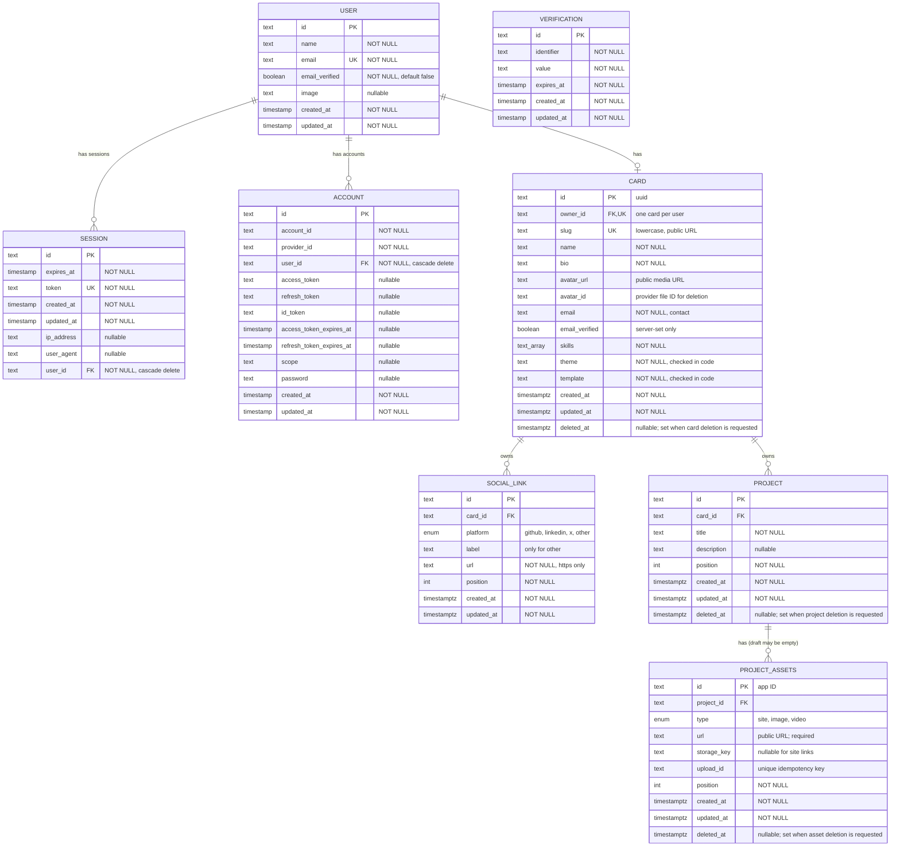

# Cardfoi Architecture

> This document captures the current architecture and data model design. Some implementation details remain open and are marked accordingly.

## Deployment and runtime

- Deploy the web application to Vercel using its serverless runtime. Vercel's free plan is the current starting assumption; confirm plan limits against expected traffic and background work before launch.
- Use Neon PostgreSQL with Drizzle ORM. The application uses the pooled Neon connection; Drizzle migrations use the direct connection.
- Keep external provider integrations behind application services so the deployment platform and provider SDKs do not leak into business logic.
- Use QStash to deliver background cleanup jobs to a shared serverless worker endpoint. The worker dispatches by job type (for example, asset, project, or card cleanup); separate worker endpoints are not needed initially.

## Authentication and authorization

- Use Better Auth for sign-in and session management. The Better Auth user is the identity record referenced by `CARD.owner_id`.
- Better Auth's admin plugin is a possible later addition for platform-level user administration. It is not currently configured, and organization administration is out of scope for this phase.
- Authenticated card operations derive the owner from the session. Public card reads use the card's public slug and expose only intended public fields.

## Media upload and deletion flows

### Provider configuration and delivery

- ImageKit is the initial media provider, isolated behind `services/media` so the application-facing interface remains provider-neutral.
- Use a shared application root folder constant (for example, `MEDIA_ROOT_FOLDER = "/cardfoi"`) and derive subfolders for avatars and project assets. Provider credentials, including the private key, remain in server-side environment variables.
- Uploaded media is public and delivered through its stable ImageKit URL. Do not use short-lived signed delivery URLs for public card pages.
- Enable and configure ImageKit referrer restrictions/hotlink protection in the provider dashboard. Treat this as a delivery-abuse control, not authorization for private content; current card media is intended to be public.

### Upload

1. The authenticated user starts an upload through the application media service.
2. The server checks ownership, resource type, and configured file/count limits, then requests short-lived upload authorization from the configured media provider. Initial accepted types are JPEG, PNG, WebP, and MP4; maximum sizes are 5 MB per image and 25 MB per video.
3. The browser uploads file bytes directly to the provider; application serverless functions do not proxy the file.
4. Each upload attempt gets a unique `upload_id`, included in the ImageKit folder/path or metadata and reused for retries. After upload succeeds, the browser sends the upload result to the app server. The server verifies the expected provider response and records `upload_id`, provider-neutral `storage_key`, and public URL in `PROJECT_ASSETS` (or avatar URL/ID on the card), associating it with the owning project/card.
5. If the upload succeeds but the database write fails, the file may be orphaned. A separate cleanup script lists files under the app's ImageKit root and removes old files whose upload IDs are not referenced in the database. Use an age threshold so active uploads are not mistaken for orphans; the threshold and schedule can be tuned during implementation.

### Deletion

1. A delete service sets the nullable `deleted_at` on the record being deleted (`CARD`, `PROJECT`, or `PROJECT_ASSETS`) and queues cleanup, allowing the user-facing request to return promptly. Child rows are not soft-deleted just because a parent is marked.
2. The QStash message identifies the cleanup job. A shared worker loads the soft-deleted record and its child rows, retaining their storage keys until provider cleanup completes.
3. The worker calls the ImageKit adapter's `deleteFile` operation for each uploaded file. Link assets have no provider file to remove.
4. After provider deletion succeeds, the worker permanently deletes the soft-deleted relational records; foreign-key cascades remove their children. If a provider deletion fails, return a retryable failure and retain the soft-deleted rows and keys.
5. The worker is idempotent: duplicate delivery and an already-deleted provider file are treated safely. QStash retries failed deliveries; exhausted failures can be inspected/retried from QStash's dead letter queue.

Card soft deletion includes avatar cleanup as well as project asset cleanup. A separate maintenance script will handle cleanup jobs that remain after QStash retries/DLQ and discover old unreferenced provider files using the `upload_id` correlation and age threshold described above.

QStash publication can fail after the database soft-delete succeeds. The delete service should report that cleanup was not queued, and the maintenance script should find the soft-deleted record and enqueue it again. The exact status/response handling will be settled during implementation.

## Data model

`USER`, `SESSION`, `ACCOUNT`, and `VERIFICATION` show the current Better Auth tables defined in `lib/db/schema/auth.ts`; authentication owns those records. The admin plugin is not enabled, so there is no `role` field in the current user schema. A user may have no card yet, and each card belongs to one user.

Skills are stored as text values separated by commas. `CARD.email` is the contact email displayed on the card. `CARD.email_verified` is derived and set by the server by comparing the normalized card contact email with the user's verified, immutable sign-in email. Recompute it when the card contact email changes.

`PROJECT` groups one or more assets, represented by `PROJECT_ASSETS`. An asset can be a site link, image, or video. Uploaded files are managed through an application media service (for example, `services/media`) so provider-specific upload and deletion code stays isolated. `storage_key` is a provider-neutral identifier used by that service to locate or delete an uploaded file.

`CARD.avatar_url` stores the public avatar URL and `CARD.avatar_id` stores the provider file identifier used by the media service for deletion. Avatar fields remain separate from `PROJECT_ASSETS`, because project assets represent project proof only. With one active media provider, the provider is selected in configuration.

Use nullable `deleted_at` columns on `CARD`, `PROJECT`, and `PROJECT_ASSETS`. `NULL` means active; set a timestamp only on the record whose deletion was requested. Keep soft-deleted rows and their media references until provider cleanup succeeds; then hard-delete rows and let foreign-key cascades remove relational children. Site/link assets have no provider file. Card deletion also queues `avatar_id`. Account deletion is not in scope for this phase.

Slug availability is enforced by a unique constraint, with reserved slugs checked separately. Rate limiting (for example, via Upstash) may be used around slug changes; it does not replace the database uniqueness constraint or the reserved-slug check.

### Database rules to consider

- Enforce unique indexes on `CARD.owner_id` and `CARD.slug`; check that `CARD.slug` is lowercase.
- Enforce the currently selected limits in application services: up to 10 skills per card, 5 projects per card, and 4 project assets per project. Database constraints may reinforce these where practical.
- Require `SOCIAL_LINK.label` only when `platform` is `other`; leave it null for the other platforms. Optionally enforce uniqueness on `(card_id, platform)` for non-`other` platforms.
- Add indexes on `(card_id, position)` for `PROJECT` and `SOCIAL_LINK`, and `(project_id, position)` for `PROJECT_ASSETS` if assets can be reordered.
- Use cascading foreign keys for permanent relational deletion, but soft-delete first and retain media references until QStash cleanup succeeds. `PROJECT_ASSETS` may be empty while a project is a draft; publishing requires at least one asset in application logic. The selected limits are 10 skills, 5 projects per card, and 4 assets per project. Bio and field-length limits remain to be specified.

## Application services and utilities

Keep business rules in app-level services so route handlers remain thin and can be reused by different interfaces. Services depend on small provider-neutral interfaces; provider SDKs, credentials, request formats, and response mapping stay inside adapters. This reduces vendor coupling, though it cannot make stored provider identifiers automatically portable: a provider migration may still require moving files and updating stored references.

Possible service boundaries:

- `services/card`: create/update a card, enforce one card per user, validate profile fields, and update the derived email badge when the contact email changes.
- `services/slug`: normalize and validate slugs, reject reserved names, enforce rename cooldowns, and handle unique conflicts. Apply shared rate limits at the request boundary if needed.
- `services/project`: create, update, reorder, publish, and delete projects; enforce per-card project and per-project asset limits. Require at least one asset when publishing, while allowing zero during drafting.
- `services/project-assets`: validate link/image/video asset fields and coordinate database changes with media upload and deletion.
- `services/media`: provider-neutral upload authorization, URL/reference handling, and deletion. It delegates to a `MediaStorageProvider` interface; the ImageKit adapter implements that interface and maps ImageKit's `fileId` to the app's `storage_key`.
- `services/social-links`: validate platform, label, URL, and ordering; enforce any chosen per-card rules.
- Shared deletion services (for example, `deleteAsset`, `deleteProject`, and `deleteCard`): soft-delete the requested record and enqueue the corresponding cleanup job. Account deletion is out of scope for now.
- `services/jobs`: publish typed cleanup jobs through a `JobQueue` interface; the QStash adapter handles QStash-specific publishing and signature verification. The cleanup route dispatches jobs to app-owned handlers.

### Offloaded provider responsibilities

- **ImageKit:** receives browser-to-provider file uploads, stores uploaded images/videos, serves public delivery URLs, applies image/video delivery transformations, and deletes files when requested. Cardfoi owns authentication, upload authorization policy, ownership checks, limits, metadata persistence, and cleanup decisions.
- **QStash:** delivers cleanup jobs to the shared worker endpoint and retries failed HTTP deliveries. Cardfoi owns job semantics, idempotency, database state, and recovery of exhausted or unpublished jobs.
- **Neon:** hosts PostgreSQL. Drizzle and Cardfoi own the schema and queries; Neon-specific connection configuration is isolated in database configuration.
- **Better Auth:** handles sign-in and sessions. Cardfoi services enforce resource ownership and product authorization. The admin plugin is not currently enabled.

### Provider-neutral contracts and configuration

- Define app-level contracts such as `MediaStorageProvider` (`createUploadAuthorization`, `deleteFile`) and `JobQueue` (`publish`). Return only app-owned types from these interfaces; do not let ImageKit/QStash SDK types escape adapters.
- Keep provider adapters in isolated modules (for example, `services/media/providers/imagekit` and `services/jobs/providers/qstash`). Select the configured adapter in one composition/configuration module.
- Keep secrets in environment variables (ImageKit private key, QStash token and signing keys, database URLs). Keep non-secret application defaults such as `MEDIA_ROOT_FOLDER = "/cardfoi"` in a constants module.
- Store the media URL for display and the provider file identifier in `storage_key` for deletion. With a single configured media provider, the provider name need not be repeated on every asset. If files from multiple providers coexist during a migration, add provider identity to the stored reference or migrate all files and keys together.
- Avoid vendor names in domain service APIs and database column names. Provider-specific identifiers still have provider-specific formats, so `storage_key` is an abstraction boundary rather than a guarantee that the identifier itself can be reused with another provider.

Possible shared utilities:

- `normalizeEmail`: trim whitespace and lowercase before comparison. Use it for the derived email badge; preserve the user's original display casing where desired.
- `normalizeSlug`: trim, lowercase, and normalize separators before reserved-name and format checks.
- `isReservedSlug` and `validateSlug`: centralize the reserved list and slug format rules.
- `validateUrl`: parse URLs and enforce allowed protocols (HTTPS for public links, with any deliberate exceptions documented).
- `getEmailBadgeStatus`: compare normalized card contact email with the verified Better Auth email. The server owns the result; clients must not set it directly.
- `enqueueMediaDeletion`: publish provider-neutral cleanup details to QStash while preserving the database references required for retries.
- `validateCardLimits`: shared checks for skill count, project count, and assets per project.
- `createUploadId`: create a UUID for each upload attempt and reuse it across retries; persist/return the existing asset when the same idempotency key is submitted again.
- `validateUploadMetadata`: server-side checks for upload ownership, expected destination, content type, size, and provider response before saving an asset.
- `buildMediaPath`: construct provider folder paths from the shared `MEDIA_ROOT_FOLDER` constant and resource IDs without leaking ImageKit URL rules into domain code.
- `verifyQStashRequest`: verify incoming worker requests in the QStash adapter/route boundary before dispatching cleanup jobs.
- `isRetryableMediaError`: classify provider deletion outcomes so the worker retries transient failures and treats an already-missing file as successfully deleted.

Keep pure normalization and validation helpers separate from services that perform database or provider I/O. The specific file layout can follow the repository's existing conventions.

## Entity relationship diagram

### Remaining implementation details

- Tune the orphan-upload age threshold and cleanup script schedule.
- Decide how upload completion is reconciled if ImageKit succeeds but the asset database insert fails; the orphan scan covers eventual cleanup.
